<div align="center">

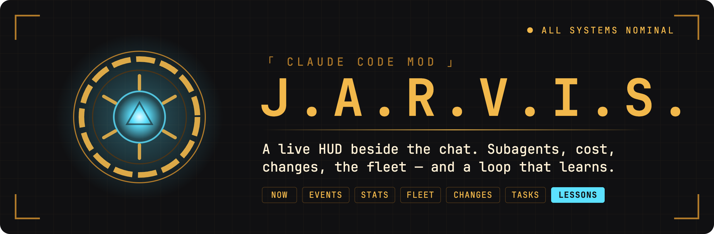

**A live HUD pane for Claude Code: your subagents, their cost, the files they touched, and every session on the machine.**

<a href="https://claude.com/claude-code"></a>


<a href="LICENSE"></a>

[Features](#features) · [Learning loop](#the-learning-loop) · [Install](#install) · [Configuration](#configuration) · [herdr](#herdr) · [Development](#development) · [License](#license)

</div>

---

<div align="center">
  <a href="docs/media/hero-tour.mp4">
    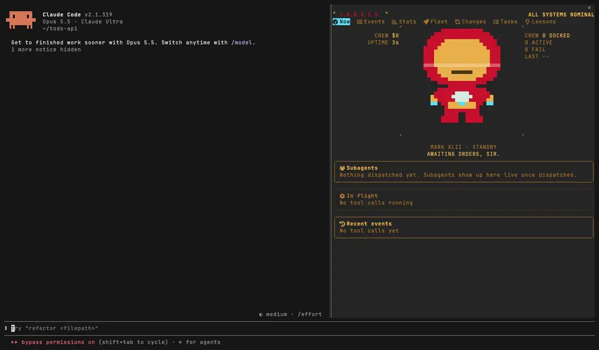
  </a>
  <br/>
  <sub>▶ <a href="docs/media/hero-tour.mp4">Watch the full tour</a></sub>
</div>

## Why Jarvis

Jarvis is a [Claude Code](https://claude.com/claude-code) mod that opens a live HUD pane beside the chat. It shows what your subagents are doing right now, what they cost, which files the session touched, and every other Claude Code session on the machine. It also keeps a record of every dispatch and turns repeated bad outcomes into rules — but only the ones you approve.

## Features

<table>
<tr>
<td width="42%" valign="middle">

### Watch subagents fan out

The **Now** tab lists every subagent in flight: type, model, task, **elapsed time**, tokens and **estimated API cost**, with the tool call each one is running and a feed of **recent events** below. Stuck and looping subagents are flagged as they happen. When nothing runs, an animated suit stands by.

</td>
<td>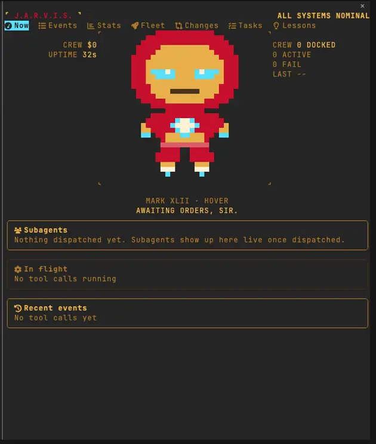</td>
</tr>
<tr>
<td width="42%" valign="middle">

### See the plan, not just the chat

The **Tasks** tab is a board the model fills through the `mcp__jarvis__task` tool: items, subtasks, which subagent owns each one, and how long it took. It also mirrors Claude Code's built-in task tools, so you see the plan and its progress at a glance.

</td>
<td>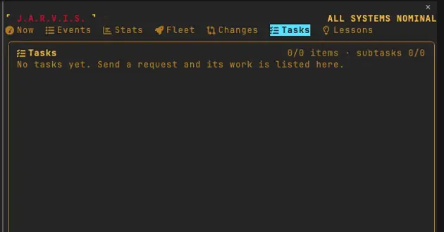</td>
</tr>
<tr>
<td width="42%" valign="middle">

### Every file the session touched

The **Changes** tab groups the files this session edited by **git repo**, with line counts and a **diff** per file. Switch to **Unpushed** for what has not left the machine, or **Commits** for ahead/behind counts and a commit graph per repo.

</td>
<td>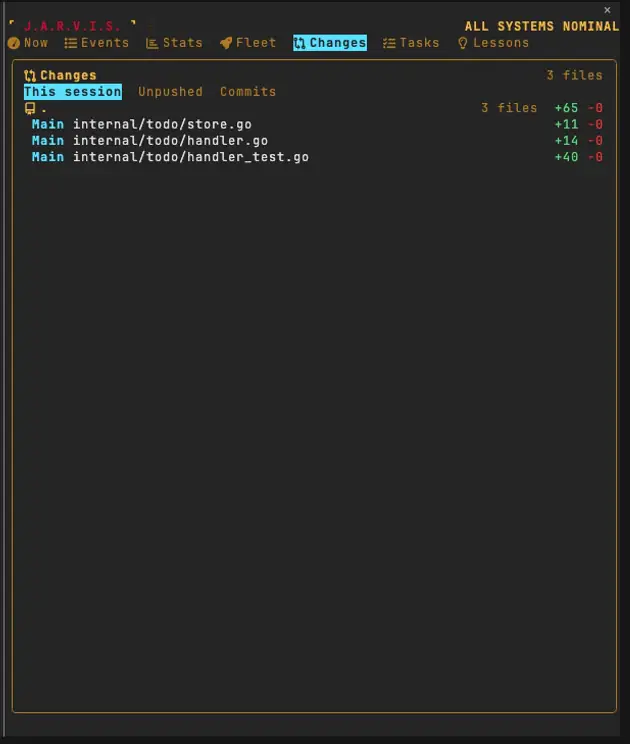</td>
</tr>
<tr>
<td width="42%" valign="middle">

### Know what it cost

The **Stats** tab counts dispatches per agent type and splits **tokens and cost per model**; the **Events** tab is a scrolling log of every tool call, per session or per subagent, which you can pause and resume.

</td>
<td>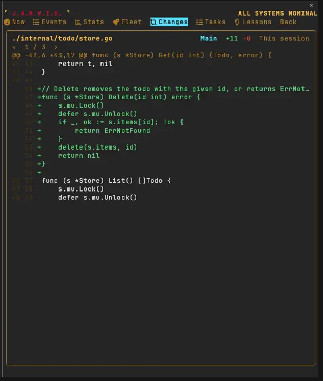</td>
</tr>
<tr>
<td width="42%" valign="middle">

### Lessons you approve

The **Lessons** tab shows **dispatch health** per agent type × model and the lessons drawn from repeated bad outcomes. Nothing changes until you press **Approve**; then the main agent writes one rule line and Jarvis measures whether it helps. See [the learning loop](#the-learning-loop).

</td>
<td>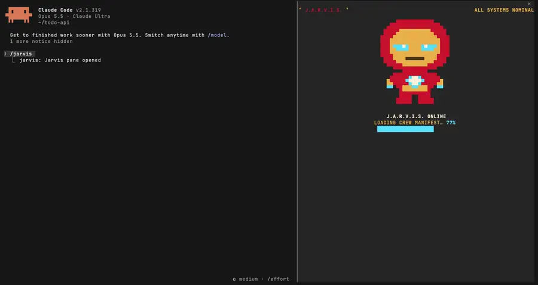</td>
</tr>
</table>

Also:

- **Fleet**: every Claude Code session in [herdr](#herdr), with its status (working / blocked / idle), last prompt and reply, today's tokens, and the 5-hour and 7-day quota. Click a session to jump to its pane.
- Writes a one-line squad summary to the herdr sidebar.
- Draws a native layout in Claude Desktop and a cell grid in the terminal.
- Speaks English and Traditional Chinese.

<details>
<summary><b>All tabs at a glance</b></summary>

| | Tab | What it shows |
| :-: | --- | --- |
| ⚡ | **Now** | Subagents in flight: type, task, elapsed time, tokens and estimated API cost. An animated suit stands by when nothing runs. |
| ☰ | **Events** | A scrolling log of tool calls, per session or per subagent. Pause and resume. |
| ▤ | **Stats** | Dispatch counts per agent type, token use and cost per model. |
| 🚀 | **Fleet** | Every Claude Code session in [herdr](#herdr): status (working / blocked / idle), last prompt and reply, today's tokens, and the 5-hour and 7-day quota. Click a session to jump to its pane. |
| ⇄ | **Changes** | Files this session edited, grouped by git repo, with diffs. Unpushed changes, ahead/behind counts and a commit graph per repo. |
| ✓ | **Tasks** | A task board the model fills through the `mcp__jarvis__task` tool, so you can see its plan and progress. |
| 💡 | **Lessons** | Dispatch health per agent type × model, and lessons drawn from repeated bad outcomes. Approve, Reject or Revert each one. |

<p align="center">
  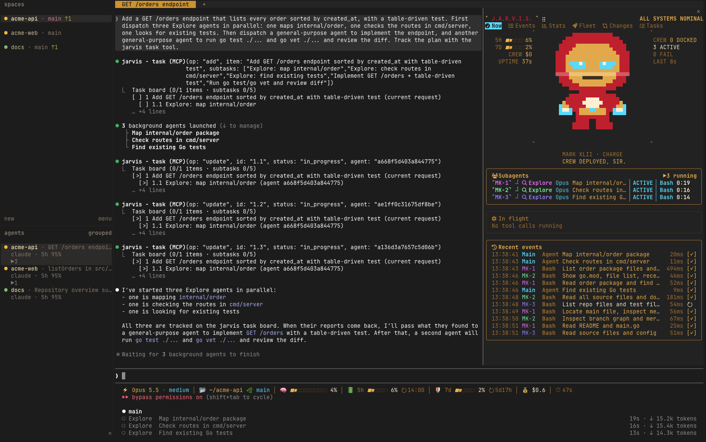
</p>

<p align="center">
  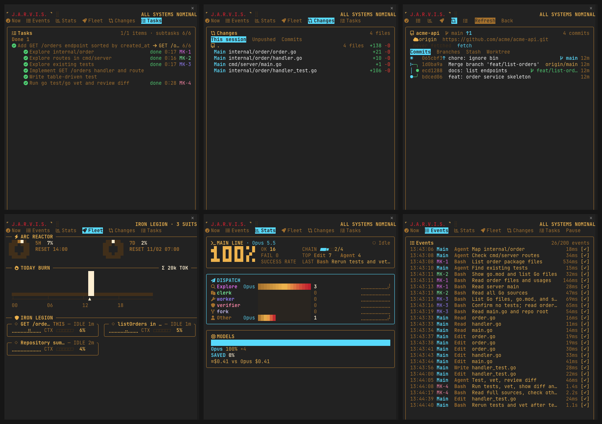
</p>

<p align="center">
  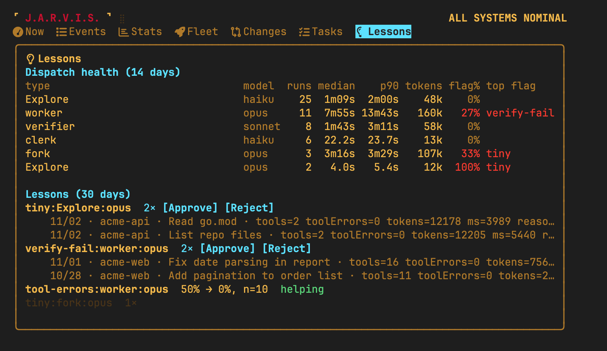
</p>

</details>

## The learning loop

<p align="center">
  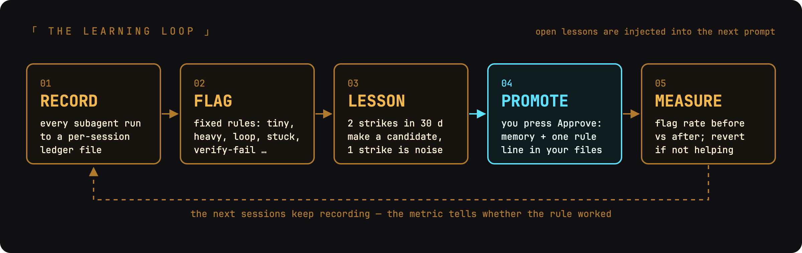
</p>

1. **Record.** Every subagent dispatch is written to `~/.claude/jarvis/ledger/<day>/<session>.jsonl`: type, model, duration, tokens, tool errors, and how it ended. Each session writes only its own file, so parallel sessions never collide. On the first run, Jarvis backfills the last 14 days from your transcripts.
2. **Flag.** Fixed rules, no model call (see the table below).
3. **Lesson.** Flags group by kind × agent type × model. One strike is noise; two strikes in 30 days make a candidate. Open candidates are added to the main agent's next prompt, once per session.
4. **Promote.** Nothing changes until you press **Approve** in the Lessons tab. Then Jarvis stores one `feedback` memory through [memory-mcp](https://github.com/ggwhite/memory-mcp) and asks the main agent to add one rule line to the right file, tagged `<!-- ev: #id -->`, and to show you the diff.
5. **Measure.** For every applied lesson, Jarvis compares the flag rate before and after. When the rule does not help, the tab offers **Revert**.

<details>
<summary><b>The flags</b></summary>

| Flag | Rule |
| --- | --- |
| `tiny` | finished with ≤ 2 tool calls (not a verifier or clerk) — you could have done it yourself |
| `heavy` | an Explore or clerk run over 300k tokens or 10 minutes |
| `tool-errors` | ≥ 3 tool errors and ≥ 30 % of its calls |
| `loop` / `stuck` | the same tool failing 3 times in a row / silent for 5 minutes |
| `error-end` | ended with an error, a refusal or an abort |
| `verify-fail` | a verifier failed the worker's result |
| `redispatch` | the same task was dispatched again |
| `corrected` | your next prompt corrects the result ("that's wrong", "你不是說…") |

</details>

## Requirements

- Claude Code with mod (function hook) support. Tested on CLI 2.1.311 and the Claude Desktop built-in 2.1.308.
- `git`, for the Changes tab.
- [herdr](#herdr) (optional), for the Fleet tab and the sidebar summary.
- [memory-mcp](https://github.com/ggwhite/memory-mcp) at `~/.local/bin/memory-mcp` (optional), for approving lessons.
- A [Nerd Font](https://www.nerdfonts.com/) in the terminal, for the icons.

## Install

Clone the repo and point Claude Code at it with `CLAUDE_CODE_PLUGIN_DIRS` (a colon-separated list):

```bash
git clone https://github.com/ggwhite/jarvis.git ~/github/jarvis
```

In `~/.claude/settings.json`:

```json
{
  "env": {
    "CLAUDE_CODE_PLUGIN_DIRS": "~/github/jarvis",
    "JARVIS_LANG": "en"
  }
}
```

Start a new session and run `/jarvis` to open the pane. To update, `git pull` and start a new session.

## Configuration

All settings are environment variables, set in the `env` block of `settings.json`.

| Variable | Values | Default |
| --- | --- | --- |
| `JARVIS_LANG` | `en`, `zh-TW` | `zh-TW` |
| `JARVIS_DESKTOP_LAYOUT` | `native`, `cells` (Claude Desktop only) | `native` |
| `CLAUDE_CODE_FORCE_TERMINAL_IMAGES` | `1` turns on the images inside herdr panes | unset |

## herdr

[herdr](https://herdr.dev) (`brew install herdr`, tested with 0.9.5) is a terminal multiplexer for coding agents. When Claude Code runs inside herdr (`HERDR_ENV=1`), Jarvis reads every pane through the `herdr` CLI to build the Fleet tab, and writes a squad summary to its own pane's sidebar. Without herdr, every tab except Fleet works as usual.

## Development

```bash
claude plugin validate .
claude plugin test .
```

The entry point is `hooks/register.tsx` (listed in `hooks/hooks.json`). Rendering and every learning-loop rule live in pure functions under `hooks/` (`ledger.ts`, `flags.ts`, `lessons.ts`, `learn.ts`), so the tests in `tests/` cover them without a live session. `integration/` holds tests that run real `git`. The banner and the loop diagram are drawn from the SVG sources in `docs/images/`.

Type checking (`npx -p typescript tsc --noEmit -p .`) needs Claude Code's mod type files in `.claude-plugin/types/`, which are not committed. The tests do not need them.

<details>
<summary><b>Recording the README clips</b></summary>

The clips in `docs/media/` are cut from real Claude Code sessions with this mod loaded, recorded headless with [vhs](https://github.com/charmbracelet/vhs). `docs/media/record/record.sh` builds a throwaway demo home (a tiny Go repo, its own `$HOME`, so no real session, ledger or memory shows up), runs a seed session and the three recorded takes (`tour.tape`, `lessons.tape`, `tasks.tape`), then `build.sh` cuts the clips into animated WebP with `img2webp`. A driver script types the prompts and clicks the tabs through `ptyproxy.py`, which forwards whole escape sequences (SGR mouse clicks) to Claude Code. The takes spend real tokens, and the cut points in `build.sh` match the committed takes, so move them after a new recording.

</details>

## License

[MIT](LICENSE)
